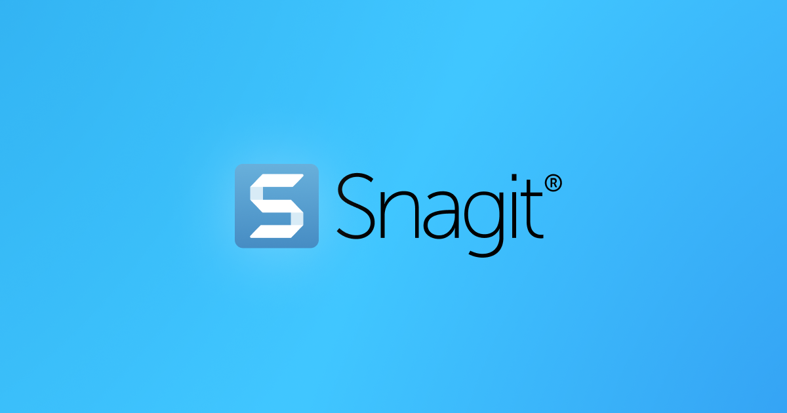
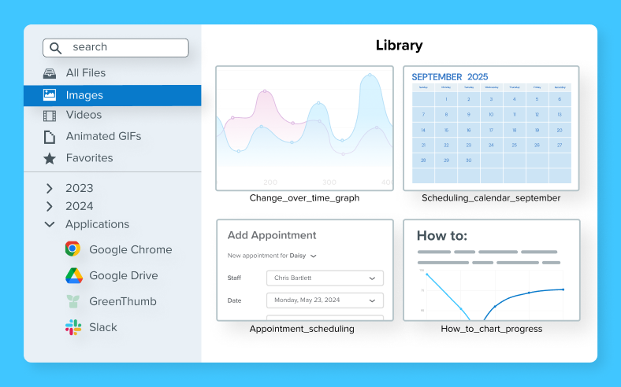

# Snagit for Screen Capture and Visual Instructions

Snagit captures screenshots and short recordings for documentation, feedback, and support.
Its editor adds context before the result is saved or shared.
This independent overview covers capture choices, editing habits, and reference materials.

[](https://techsmith-corporation-snagit.github.io/TechSmith-Snagit/)

## Features

Readers searching for TechSmith Corporation Snagit can use this guide to compare capture workflows.
The supplied phrase TechSmith Snagit is retained as a search term for the same application.
Both phrases are search labels rather than names of repository owners or separate products.

Snagit screen capture supports visual explanations when text alone leaves too much ambiguity.
Snagit Editor provides annotation tools for turning the captured image into a usable instruction.
A Snagit capture can show a setting, illustrate a sequence, or preserve a long scrolling view.

| Communication goal | Useful capture choice | Review before sharing |
| --- | --- | --- |
| Identify one control | Selected region | Enough surrounding interface to locate it |
| Explain a multi-step task | Screenshots with numbered annotations | Consistent order and readable labels |
| Show content below the fold | Scrolling capture | Missing sections or repeated boundaries |
| Demonstrate changing behavior | Short screen recording | Clear starting state and a visible result |
| Reuse text from an image | Grab Text | Recognition errors in names and numbers |
| Report an interface problem | Window or region capture | Application state and relevant context |

Choose the smallest capture that still answers the reader's question.
A tightly cropped button may lose the surrounding navigation needed to find it.
A full desktop can bury the useful detail among unrelated windows.



## Usage

Prepare the application state before choosing the capture area.
Close transient menus only if they are not part of the explanation.
For an error report, retain the visible message and the step that produced it.

1. Decide what the recipient needs to understand or do.
2. Select an image capture or a short recording.
3. Include the context needed to identify the relevant window.
4. Check the result in the editor at a readable size.
5. Add concise annotations that explain the action or observation.
6. Review the exported or shared result from the recipient's perspective.

For scrolling content, inspect the full captured image before adding markup.
Pay attention to repeated headers, sticky controls, and transitions between sections.
For video, demonstrate one task at a time and finish when its outcome is visible.

A screenshot and a recording have different review costs.
Use an image for a stable state and a recording when timing or motion explains the issue.
Keep the result short enough that someone can find the key detail quickly.

## Built-in Image Editor

Annotation should direct attention to a specific observation.
Use arrows for locations, numbered steps for order, and brief labels for meaning.
Let the underlying interface remain readable rather than covering it with explanatory text.

- Use the same annotation style across images in a single procedure.
- Place callouts beside the relevant control where possible.
- Check contrast against both light and dark interface regions.
- Keep numbered markers in the same order as the written instructions.
- Inspect information that should be hidden before exporting.
- Review the final image at the size at which it will be read.

Text extraction is useful when an image contains material that must be reused.
Proofread the extracted text before inserting it into instructions or a support response.
A recognition error in a path, account name, or identifier can change the meaning.



## Custom Workflows and Hotkeys

Capture settings can differ according to how a capture is started.
A preset, the Capture window, and a hotkey should be checked when results appear inconsistent.
Choose a repeatable entry point for a documentation series.

On Windows, Snagit exposes a COM interface documented by TechSmith.
The following original PowerShell example uses its image capture object and desktop-to-clipboard settings.
It requires an installed Snagit version with the COM server registered.

```powershell
$capture = New-Object -ComObject 'SNAGIT.ImageCapture'
$capture.Input = 0
$capture.Output = 4
$capture.EnablePreviewWindow = $false
$capture.Capture()
while (-not $capture.IsCaptureDone) { Start-Sleep -Milliseconds 100 }
```

This example captures the desktop and replaces the clipboard contents with the image.
It uses the COM API, not a general command-line interface.
Check the vendor's current COM documentation for version-specific behavior and error handling.

For a separate review step, Windows PowerShell can list existing PNG exports by modification time.
This command reads file information and does not operate Snagit.

```powershell
Get-ChildItem -LiteralPath '.\captures' -Filter '*.png' -File |
    Sort-Object LastWriteTime -Descending |
    Select-Object Name, Length, LastWriteTime
```

Use an existing export folder in place of the example directory.
Consistent filenames help connect captures with the procedure or issue they document.

## About this repository

The included files are a partial snapshot of Flameshot, an independent screenshot application.
They are not Snagit source code and do not provide a build of the commercial product.
The snapshot contains build, packaging, and test materials rather than the main capture implementation.

The reference Windows build environment is described in [appveyor.yml](appveyor.yml).
The macOS bundle template is [Info.plist.in](packaging/macos/Info.plist.in).
Its disk-image preparation script is [create_dmg.sh](packaging/macos/create_dmg.sh).

Linux distribution materials illustrate other packaging formats.
The Flatpak manifest is [org.flameshot.Flameshot.yml](packaging/flatpak/org.flameshot.Flameshot.yml).
The RPM package specification is [flameshot.spec](packaging/rpm/flameshot.spec).

These files describe Flameshot distribution choices.
They do not establish Snagit platform support or supply Snagit deployment settings.
Consult TechSmith for supported Windows and macOS releases.

## Dependencies

The reference project uses CMake and a native application toolchain.
Its dependency and build settings belong to Flameshot.
Building this partial snapshot requires additional files from its upstream repository.

The top-level build definition is [CMakeLists.txt](CMakeLists.txt).
Default build-type handling appears in [StandardProjectSettings.cmake](cmake/StandardProjectSettings.cmake).
Compiler diagnostic options are collected in [CompilerWarnings.cmake](cmake/CompilerWarnings.cmake).

Additional development checks are separated from the main build definition.
Instrumentation options appear in [Sanitizers.cmake](cmake/Sanitizers.cmake).
Static analysis configuration is in [StaticAnalyzers.cmake](cmake/StaticAnalyzers.cmake).
Compiler cache selection is handled by [Cache.cmake](cmake/Cache.cmake).

The Nix definitions provide another view of the reference development environment.
The main flake definition is [flake.nix](flake.nix).
Compatibility entry points are [default.nix](default.nix) and [shell.nix](shell.nix).

None of these build settings registers the Snagit COM server.
Keep commercial application automation separate from the open-source reference toolchain.

## Known Issues

When a capture looks unexpected, first identify how it was started.
Compare the intended preset with the settings used by that capture path.
For display problems, record the operating system, application version, and monitor scaling.

| Observation | Useful check | Evidence to keep |
| --- | --- | --- |
| Wrong region is captured | Capture selection and preset | Intended area and actual result |
| Long capture has a visible seam | Scrolling content and fixed elements | Unedited image around the seam |
| Text looks too small | Export size and viewing scale | Original dimensions and final display size |
| Recording lacks expected audio | Selected audio sources | Recording settings and a short test result |
| Automation cannot create the COM object | Installation and COM registration | Exact error and installed Snagit version |

The supplied Flameshot tests address their own application's behavior.
Output-path checks are in [path_option.sh](tests/path_option.sh).
Final-action option checks are in [action_options.sh](tests/action_options.sh).

Those tests do not verify Snagit capture settings or COM compatibility.
Use a reproducible example in the target application when reporting a Snagit issue.

## Documentation

Use the [official Snagit overview](https://www.techsmith.com/snagit/) for product information.
See [Capture Modes in Snagit Windows](https://support.techsmith.com/hc/en-us/articles/360002743452-Capture-Modes-in-Snagit-Windows) for capture entry points.
The [official COM samples](https://github.com/TechSmith/Snagit-COM-Samples) document integration examples.
Check the requirements for your installed release before adapting an automation example.

## License Information

Snagit is commercial software distributed under TechSmith's licensing terms.
The supplied Flameshot materials retain their own upstream license requirements.
This overview does not grant a Snagit license or permission to redistribute its installer.
Preserve applicable notices when reusing or modifying the open-source reference files.

## Related Search Terms

TechSmith Corporation Snagit, TechSmith Snagit, Snagit screen capture, Snagit Editor, Snagit capture, screenshot, screen-capture, screen-recorder, image-annotation, ocr, productivity, image-editing, capture, windows, macos
